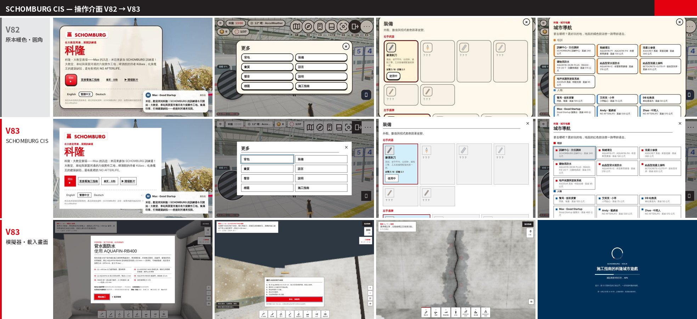

# Schomburg in Taiwan by Good Startup

**SCHOMBURG Application Guides · SCHOMBURG 施工指南**

[English](#english) · [繁體中文](#繁體中文) · **Live:** <https://maxlu1980.github.io/Schomburg-in-Taiwan-by-Good-Startup/>

One self-contained web page with six interactive application guides for SCHOMBURG
construction-chemistry systems, hands-on 3D simulators, a document generator and a training
game set in Köln — in **English**, **Traditional Chinese (Taiwan)** and **German**.
Published by Good Startup LTD. (好時新創有限公司), authorised SCHOMBURG distributor for Taiwan.

> Status: **V84** — production. Every build is checked by the QA harness in `qa/`
> (routes × languages × themes, documents, simulators, game, layout, accessibility).



> V84 added the full accessibility pass (axe-core, WCAG 2.1 AA: 0 violations in 44 views of the guides and 14 of the game) — see `docs/previews/v84-qa-preview.jpg` and `CHANGELOG.md`.

---

## English

### What is in the page

| Guide | Systems | Simulator |
|---|---|---|
| Crack injection | AQUAFIN-P1, AQUAFIN-P4, ASODUR-EKF, ASOCRET-M30 | a water-bearing wall crack: packers, sealing, grouting from the lowest packer up |
| Concrete restoration | ASOCRET-HS-FLEX, ASOCRET-BIS-5/40, ASOCRET-BIS-1/6, ASOCRET-IM | a corroding beam: break-out, corrosion protection, bond coat, repair mortar, fine filler |
| Mineral waterproofing | AQUAFIN-1K, AQUAFIN-2K/M-PLUS, AQUAFIN-RB400, FIX-20-T, ASOCRET-M30 | a basement wall from the inside: jet washing, repairs with ASOCRET-M30, pre-seal with AQUAFIN-1K, two coats of AQUAFIN-RB400 |
| Retrospective (crystalline) waterproofing | AQUAFIN-IC, ASOCRET-IM, FIX-20-T | a leaking construction joint: stop the water with FIX-20-T, fillet with ASOCRET-IM, AQUAFIN-IC on the wall |
| Crystalline admixture | BETOCRETE-CL170-P, AQUAFIN-CJ5, AQUAFIN-CJ6 | a watertight basement: dose the admixture at the plant, joint tapes, pour, cure |
| Protective flooring | ASODUR-SG3, ASODUR-B351, ASODUR-V360W | a garage floor over a weekend: ASODUR-V360W primer, levelling, seal, anti-slip |

Every guide has: the application steps with consumption and timing from the technical data
sheets, a product menu, a 3D scene, a knowledge check, a **document generator** (product
sheet, quotation, method statement, specification text, technical submittal, product
comparison — as a preview, Word `.docx` or PDF, in all three languages), and a hands-on
**simulator** that is played with the mouse or by touch (the tools, the mixing ratios, the
pot life and the coverage are checked against the data sheets).

The **Köln training game** ("SCHOMBURG · KÖLN") puts the six guides on practice sites in a
true-scale downtown Köln (Kölner Dom, Hohenzollernbrücke, Hauptbahnhof, the Rhine): the
player collects a stamp per guide by visiting, answering and simulating, and meets the
"building defects" as bosses. It runs in the same page (WebGL, three.js), on phones too.

The operating interface of the page, the simulators and the game follows the SCHOMBURG
corporate design: one red for the primary action, black hairlines, white and grey grounds,
square corners, Futura (Jost) Bold / Book / Light, Noto Sans TC for Chinese, blue for focus
and progress, with a night theme.

### Quick start

```bash
git clone https://github.com/maxlu1980/Schomburg-in-Taiwan-by-Good-Startup.git
cd Schomburg-in-Taiwan-by-Good-Startup
npm ci                 # three.js, pdfmake, docx (+ Playwright, axe-core for the QA harness)
python3 build.py       # → dist/index.html, dist/aquafin-p4-guide.artifact.html, dist/aquafin-p4-injection-guide.html
npm run serve          # http://127.0.0.1:8765/dist/index.html
```

Requirements: Node ≥ 18, Python ≥ 3.9 (the build uses only the standard library). Playwright's
Chromium is needed only for the tests (`npx playwright install chromium`); Pillow (`pip install pillow`)
only for the screenshot contact sheets some tests assemble.

### The three flavours of the page

| File | Fonts | Libraries | Use |
|---|---|---|---|
| `dist/index.html` | files in `dist/fonts/` | files in `dist/lib/` | a web server, GitHub Pages (the Pages workflow deploys it) |
| `dist/aquafin-p4-injection-guide.html` | embedded | jsDelivr CDN | **the standalone file** — one file to send or open from disk (≈ 14 MB; needs internet for the libraries) |
| `dist/aquafin-p4-guide.artifact.html` | files | jsDelivr CDN | the hosted-artifact flavour (publish together with `dist/fonts/`) |

### Repository layout

```
build.py                 assembles the page from src/ (see the docstring)
src/
  body.html, style.css, app.js        the site: guides, menus, documents, the 3D scenes
  hsim.js, hsaudio.js                 the hands-on simulators and their sound
  de.js                               the German dictionaries — GENERATED by i18n/assemble.py, do not edit
  boot.js, head.html, standalone-head.html, logo-data.js
  koeln/                              the Köln game
    isle/                             the Köln parts (k_*.js, kt_*.js), k_style.css, k_cis.css (SCHOMBURG CIS)
    city/                             the city model parts → koeln3d.js (game/tools/mkcity.sh)
    lib/                              engine modules (characters, props, sky, audio)
    kw.js                             the world: sky, light, weather
    kisle.js                          the assembled game — GENERATED by game/tools/port.py (see below)
    isle.css                          the game's stylesheet — GENERATED by game/tools/mkcss.py
fonts/                   Jost + Noto Sans TC subsets (OFL 1.1)
i18n/                    en.json (the English dictionaries), chunks/ and de/ (the German, chunk by chunk), assemble.py, split.py
cmp/                     the product-comparison data pipeline (research → cmp_new.json → src/app.js)
game/
  tools/                 port.py (assembles kisle.js), mkcss.py, mkcity.sh, namecheck.py, the kpatch_*.py patch sets, model and music sources
  css/isle_raw.css       the engine's base stylesheet
  dom/                   the cathedral's build parts (→ src/koeln/city/k3d_dom.js)
  tts/                   Mira's voice lines and the generator script (the model is not included)
qa/                      the QA harness (Playwright): see below
ktest/                   small pages that load the game alone (used by the game harness)
docs/                    DEVLOG.md (the development log, V61–V84), previews/, FACTS (the city research)
```

### Build pipeline

```
i18n/en.json + i18n/de/*.json  ──assemble.py──▶  src/de.js
game/css/isle_raw.css + src/koeln/isle/k_style.css + k_cis.css  ──mkcss.py──▶  src/koeln/isle.css
src/koeln/city/*.js  ──mkcity.sh──▶  src/koeln/koeln3d.js
game/ref/parts/*.js (reference engine, not included) + src/koeln/isle/*.js + kpatch_*.py  ──port.py──▶  src/koeln/kisle.js
src/* + fonts/* (+ node_modules)  ──build.py──▶  dist/*
```

`make all` runs the first three generators and the build; `make check` the static checks.

**What is not in the repository.** The game is assembled from the parts of a reference engine
(`game/ref/`, an earlier project of the same author) by `game/tools/port.py`; those parts are
not published here. The assembled `src/koeln/kisle.js` *is* committed, so the page builds and
runs from the repository as it is — only re-assembling the game from the reference needs
`game/ref/`. The same goes for the voice model behind `game/tts/make_vox.py`.

### Quality checks (`qa/`)

Start the server (`npm run serve`) and run from the repository root:

| Command | What it checks |
|---|---|
| `npm run check` | every script parses as ES5, no duplicate top-level names across the game parts, no secrets or sandbox paths in the build, i18n keys |
| `npm run validate:html` | html-validate on the standalone file (the rules for text that is filled in at run time — empty headings, button and link names, the six `<main>` landmarks named by their titles — are switched off in `.htmlvalidate.json`; axe checks them live) |
| `npm test` | every route × en/zh/de × light/night loads with no page error |
| `npm run test:a11y` | axe-core (WCAG 2.1 AA + best practice) on every route, language and theme, phone and desktop, the simulator and the injection brief |
| `npm run test:layout` | 6 routes × 6 viewports: no sideways overflow, nothing outside the viewport, no clipped labels, touch targets |
| `npm run test:leaks` / `test:docs` | no English left after switching to German; every document kind × guide × language generates (preview, Word, PDF) |
| `npm run test:sim` / `test:sim:full` | the simulators on phone/tablet/desktop with synthetic touch; every phase of all five simulators completes |
| `npm run test:game` / `test:game:a11y` / `test:film` | the game's cards and HUD on desktop and phone, collisions, controls, graphics settings, indoors; axe on the game; the opening film on the audio clock |

### Deployment

* **GitHub Pages**: enable Pages (Settings → Pages → Source: *GitHub Actions*); `.github/workflows/pages.yml`
  builds and deploys `dist/index.html` with its fonts and libraries, and the standalone file as `schomburg-application-guides.html` — live at <https://maxlu1980.github.io/Schomburg-in-Taiwan-by-Good-Startup/>.
* **Any static host**: copy `dist/index.html`, `dist/fonts/`, `dist/lib/`.
* **Offline / e-mail**: send `dist/aquafin-p4-injection-guide.html`.

### Browser support

The page is written in ES5 and runs in current Chrome, Edge, Safari (iOS/macOS) and Firefox.
The simulators and the game need WebGL; the page detects the hardware and recommends a
graphics setting (the game keeps 30 fps automatically on *High/Ultra*).

### Licence

Code: MIT (see `LICENSE`). Trademarks, product data, fonts and libraries: see `NOTICE.md`.

---

## 繁體中文

### 這是什麼

一個單一網頁，內含 SCHOMBURG 建築化學系統的六本互動式施工指南、動手做 3D 模擬器、文件產生器，
以及以科隆為舞台的訓練遊戲；提供**英文**、**繁體中文（台灣用語）**與**德文**三種語言。
由 SCHOMBURG 台灣授權經銷商好時新創有限公司（Good Startup LTD.）發布。

| 指南 | 系統 | 模擬器 |
|---|---|---|
| 裂縫灌注 | AQUAFIN-P1、AQUAFIN-P4、ASODUR-EKF、ASOCRET-M30 | 滲水的牆面裂縫：灌注針頭、封閉、由最低點往上灌注 |
| 混凝土修復 | ASOCRET-HS-FLEX、ASOCRET-BIS-5/40、ASOCRET-BIS-1/6、ASOCRET-IM | 鏽蝕的樑：鑿除、鋼筋防鏽、黏結層、修補砂漿、細批土 |
| 礦物系防水 | AQUAFIN-1K、AQUAFIN-2K/M-PLUS、AQUAFIN-RB400、FIX-20-T、ASOCRET-M30 | 地下室外牆由內側施作：水刀處理、ASOCRET-M30 修補、AQUAFIN-1K 預先封閉、AQUAFIN-RB400 兩道 |
| 結晶型背水面防水 | AQUAFIN-IC、ASOCRET-IM、FIX-20-T | 滲水的施工縫：FIX-20-T 止水、ASOCRET-IM 導角、AQUAFIN-IC 塗布 |
| 結晶型混凝土摻料 | BETOCRETE-CL170-P、AQUAFIN-CJ5、AQUAFIN-CJ6 | 水密地下室：拌合廠摻料計量、止水帶、澆置、養護 |
| 地坪保護與塗裝 | ASODUR-SG3、ASODUR-B351、ASODUR-V360W | 週末完成的車庫地坪：ASODUR-V360W 底漆、整平、封閉、防滑 |

每本指南都有：依技術資料表的施工步驟（用量與時間）、產品選單、3D 場景、知識測驗、
**文件產生器**（產品說明、報價單、施工計畫書、規範文字、技術送審、產品比較；預覽、Word 或 PDF，三種語言），
以及用滑鼠或觸控操作的**模擬器**（工具、拌合比例、可使用時間與覆蓋率都依資料表檢核）。

**科隆訓練遊戲**（SCHOMBURG · KÖLN）把六本指南放進等比例的科隆市中心（大教堂、霍亨索倫橋、中央車站、萊茵河）：
玩家逐一到訪、作答、模擬以集滿印章，並與化身的「建築缺陷」對決。同一網頁、WebGL（three.js），手機也能玩。

網頁、模擬器與遊戲的操作介面皆採 SCHOMBURG 企業識別：主要動作用一種紅色、黑色細框線、白與灰底、直角、
Futura（以 Jost 代替）Bold / Book / Light、中文用 Noto Sans TC、聚焦與進度用藍色，並有夜間模式。

### 快速開始

```bash
git clone https://github.com/maxlu1980/Schomburg-in-Taiwan-by-Good-Startup.git
cd Schomburg-in-Taiwan-by-Good-Startup
npm ci                 # three.js、pdfmake、docx（以及測試用的 Playwright、axe-core）
python3 build.py       # → dist/index.html、dist/aquafin-p4-guide.artifact.html、dist/aquafin-p4-injection-guide.html
npm run serve          # http://127.0.0.1:8765/dist/index.html
```

需求：Node ≥ 18、Python ≥ 3.9（建置只用標準函式庫）。只有測試需要 Playwright 的 Chromium（`npx playwright install chromium`）；部分測試拼接截圖總覽時需要 Pillow（`pip install pillow`）。

### 三種版本

| 檔案 | 字型 | 函式庫 | 用途 |
|---|---|---|---|
| `dist/index.html` | `dist/fonts/` 檔案 | `dist/lib/` 檔案 | 網站伺服器、GitHub Pages（由 Pages 工作流程部署） |
| `dist/aquafin-p4-injection-guide.html` | 內嵌 | jsDelivr CDN | **單機版**：一個檔案即可寄送或直接開啟（約 14 MB；函式庫需要網路） |
| `dist/aquafin-p4-guide.artifact.html` | 檔案 | jsDelivr CDN | 託管 artifact 版（連同 `dist/fonts/` 一起發布） |

### 建置流程

```
i18n/en.json + i18n/de/*.json  ──assemble.py──▶  src/de.js
game/css/isle_raw.css + src/koeln/isle/k_style.css + k_cis.css  ──mkcss.py──▶  src/koeln/isle.css
src/koeln/city/*.js  ──mkcity.sh──▶  src/koeln/koeln3d.js
game/ref/parts/*.js（參考引擎，未收錄）+ src/koeln/isle/*.js + kpatch_*.py  ──port.py──▶  src/koeln/kisle.js
src/* + fonts/*（+ node_modules）  ──build.py──▶  dist/*
```

`make all` 執行前三個產生器與建置；`make check` 執行靜態檢查。

**未收錄的部分。** 遊戲由 `game/tools/port.py` 從參考引擎（`game/ref/`，作者早先的專案）的零件組合而成，
該零件未隨本儲存庫發布；但組合後的 `src/koeln/kisle.js` 已提交，因此儲存庫可直接建置與執行，
只有「重新從參考引擎組合遊戲」需要 `game/ref/`。`game/tts/make_vox.py` 所用的語音模型亦同。

### 品質檢查（`qa/`）

先啟動伺服器（`npm run serve`），在儲存庫根目錄執行：

| 指令 | 檢查內容 |
|---|---|
| `npm run check` | 所有腳本皆可以 ES5 解析、遊戲零件沒有重複的頂層名稱、建置結果沒有機密或沙箱路徑、i18n 鍵值 |
| `npm run validate:html` | 以 html-validate 檢查單機版（執行期才填入的文字——空標題、按鈕與連結名稱、六個以各自標題命名的 `<main>`——其規則於 `.htmlvalidate.json` 關閉，改由 axe 於執行期檢查） |
| `npm test` | 每個頁面 × 英／中／德 × 日／夜 載入皆無錯誤 |
| `npm run test:a11y` | axe-core（WCAG 2.1 AA 與最佳實務）：每個頁面、語言、主題，手機與桌機，模擬器與灌注簡報 |
| `npm run test:layout` | 6 個頁面 × 6 種視窗：無橫向溢出、無超出視窗、無被截斷的文字、觸控目標 |
| `npm run test:leaks` / `test:docs` | 切到德文後沒有殘留英文；每種文件 × 指南 × 語言都能產生（預覽、Word、PDF） |
| `npm run test:sim` / `test:sim:full` | 模擬器在手機／平板／桌機的合成觸控操作；五個模擬器每個階段都能完成 |
| `npm run test:game` / `test:game:a11y` / `test:film` | 遊戲在桌機與手機的卡片與 HUD、碰撞、操控、畫質設定、室內；遊戲的 axe 檢查；開場影片的音訊時脈 |

### 部署

* **GitHub Pages**：啟用 Pages（Settings → Pages → Source：*GitHub Actions*）；`.github/workflows/pages.yml`
  會建置並部署 `dist/index.html`（含字型與函式庫），並附上單機版 `schomburg-application-guides.html`；網址 <https://maxlu1980.github.io/Schomburg-in-Taiwan-by-Good-Startup/>。
* **任何靜態主機**：複製 `dist/index.html`、`dist/fonts/`、`dist/lib/`。
* **離線／電子郵件**：寄送 `dist/aquafin-p4-injection-guide.html`。

### 授權

程式碼：MIT（見 `LICENSE`）。商標、產品資料、字型與函式庫：見 `NOTICE.md`。
